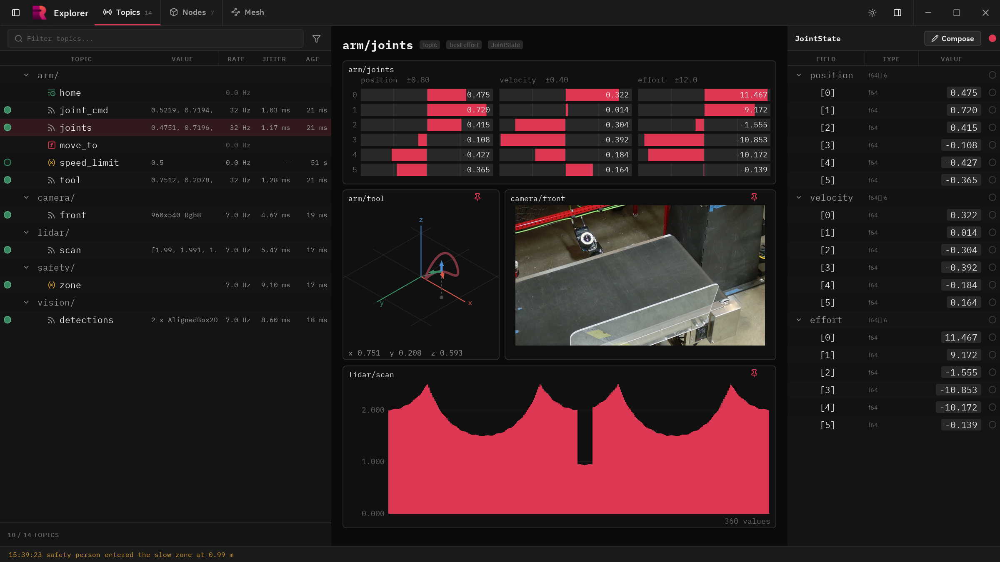
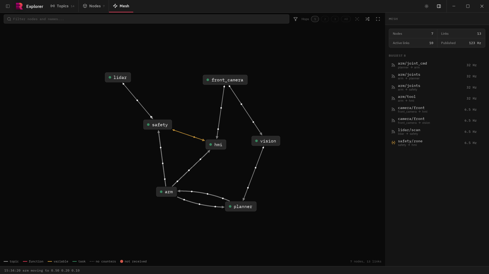
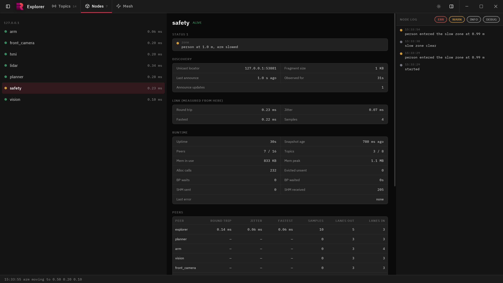

# Rant Explorer

A GUI tool to browse and easily visualize anything on a Rant network. Runs native or on the
web through the Rant bridge.







## Install

```
rant install explorer
```

## Usage

```
rant explore                 # open the explorer
rant run WebExplorer         # serve it as a page on port 6732
```

The page reaches the network through a Rant bridge on the same host (`rant install bridge`,
then `rant enable Bridge`). With a bridge running, https://explore.rantlib.dev works too.

## Build

```
cmake --preset windows       # or linux, macos
cmake --build --preset windows
```

The web page builds with `cmake --preset web` and the emsdk in `EMSDK`. The Linux packages
it needs are listed in `.github/workflows/ci.yml`.
